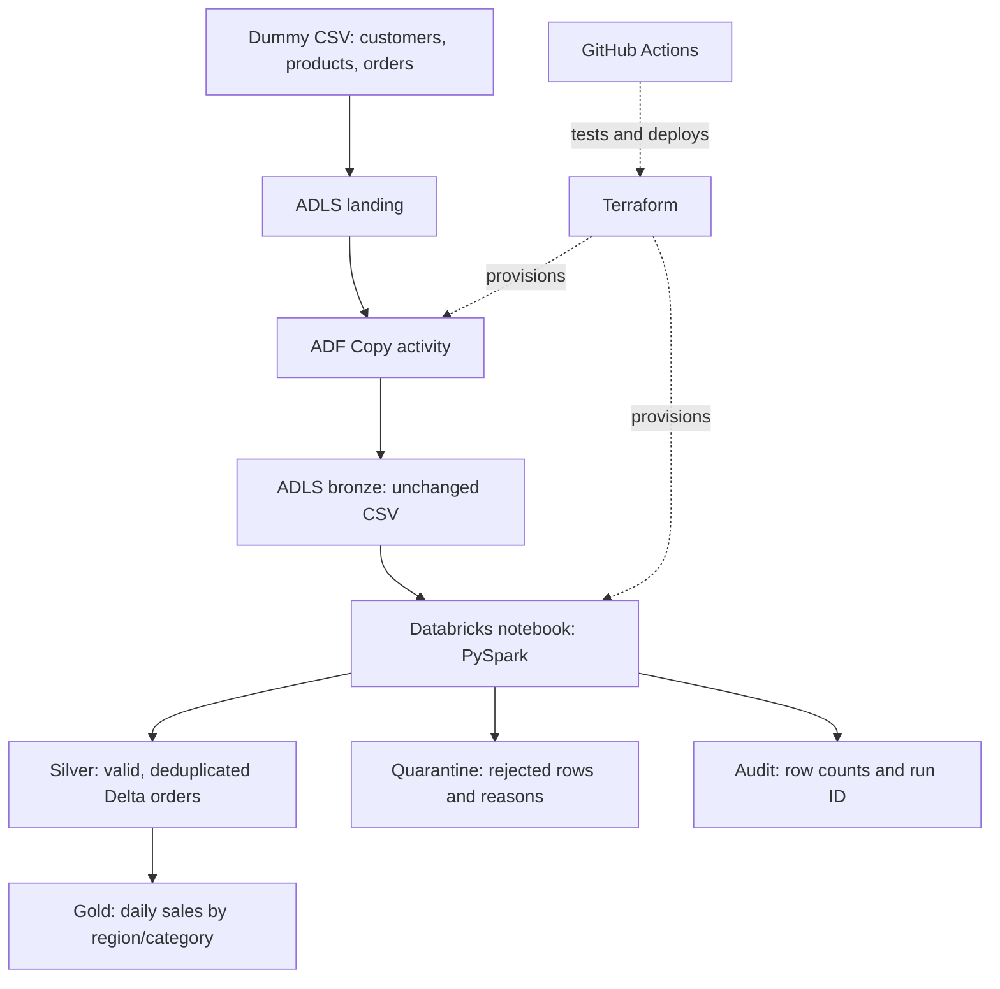

# Cloud ETL Pipeline — Azure Databricks + Data Factory + Terraform + CI/CD

A complete **learning project** for Amit's [Azure-Cloud-ETL-project](https://github.com/amitkrg83/Azure-Cloud-ETL-project).
Run a real Spark pipeline locally, then deploy the Azure version when ready.
The dataset is fictional retail sales, with deliberate errors that make each ETL step visible.

## Start locally — no Azure account needed

Prerequisites: Git, **Python 3.10–3.12**, and **Java 17** (`java -version`).
On Apple Silicon, install native ARM64 Python and Java; set `JAVA_HOME` if Java is not detected.

```bash
git clone https://github.com/amitkrg83/Azure-Cloud-ETL-project.git
cd Azure-Cloud-ETL-project
# If using the downloadable project, unpack it and cd into its folder instead.
python3 -m venv .venv
source .venv/bin/activate
python -m pip install -e '.[dev]'
python scripts/run_local.py
python -m pytest -q
```

If Spark cannot resolve your Mac hostname:
```bash
SPARK_LOCAL_IP=127.0.0.1 python scripts/run_local.py
```

Local execution uses PySpark + Parquet. Azure execution uses the **same transformation functions**,
with Delta Lake and Unity Catalog. The local run does not emulate ADF, Azure identities, or Delta transactions.

## What connects to what?



| Piece | What it does | File to open |
|---|---|---|
| Dummy data | 3 customers, 3 products, 12 order records | `data/sample/*.csv` |
| Bronze | Exact source copy; retains duplicates and invalid values | ADF Copy in `infra/azure/main.tf` |
| Silver | Casts values, validates, joins dimensions, keeps latest valid order | `src/cloud_etl/transforms.py` |
| Quarantine | Retains original JSON plus rejection reasons | `transform()` in the same module |
| Gold | Sums completed sales by date, region, category | `transform()` in the same module |
| Databricks | Executes Spark and writes external Delta tables | `notebooks/run_pipeline.py` |
| Unity Catalog | Grants identity access to external storage/table namespace | `infra/databricks/main.tf` |
| Data Factory | Runs Copy → Notebook with retries and concurrency=1 | `infra/azure/main.tf` |
| Terraform | Creates Azure resources, identities, permissions, and notebook | `infra/azure`, `infra/databricks` |
| CI | Runs tests, local example, lint, Terraform validation | `.github/workflows/ci.yml` |
| CD | Manual OIDC deployment, sample upload, ADF run | `.github/workflows/deploy.yml` |
| Monitoring | ADF pipeline/activity diagnostics to Log Analytics | `infra/azure/main.tf` |

## Expected result

| Metric | Expected |
|---|---:|
| Raw records | 12 |
| Silver orders | 5 |
| Quarantine records | 5 |
| Duplicate/superseded records removed | 2 |
| Gold groups | 4 |
| Completed sales revenue | $550.00 |

| Date | Region | Category | Orders | Units | Revenue |
|---|---|---|---:|---:|---:|
| 2026-10-01 | California | Furniture | 1 | 1 | 200.00 |
| 2026-10-01 | Texas | Electronics | 1 | 2 | 100.00 |
| 2026-10-02 | California | Electronics | 1 | 3 | 150.00 |
| 2026-10-02 | Texas | Electronics | 1 | 4 | 100.00 |

Local outputs appear under `output/`: bronze CSV, silver/gold/quarantine Parquet, and `metrics.json`.
The local runner asserts the exact expected metrics for the supplied sample; update that fixture when changing the dataset.

## Learn and deploy

1. Read [the step-by-step walkthrough](docs/WALKTHROUGH.md).
2. Follow [Azure setup and deployment](docs/AZURE_SETUP.md).
3. Follow [GitHub Actions configuration](docs/CICD.md).
4. Use [troubleshooting and cleanup](docs/OPERATIONS.md).

This is a small, full-snapshot, public-endpoint demo. It does not implement streaming, Auto Loader,
Great Expectations, private networking, Power BI provisioning, or production SLAs.
Cloud deployment requires your Azure login, permissions, a Unity Catalog metastore/catalog, and compute quota.
No Azure resources are created by the local commands.

MIT license: see [LICENSE](LICENSE).
